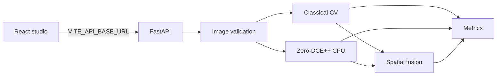
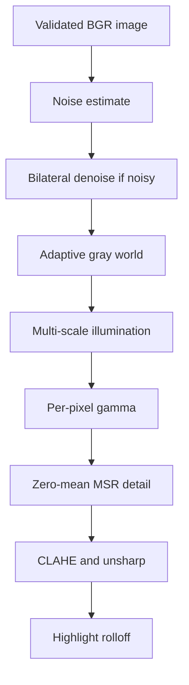

# Architecture

The browser never synthesizes a result. Mode buttons follow `GET /api/info`. Temp files use `tempfile.mkstemp` with a UUID prefix and are removed in a `finally` block.

## Configuration

| Variable | Role |
| --- | --- |
| `PORT` | Uvicorn port. Render sets it. |
| `ALLOWED_ORIGINS` | Comma-separated CORS origins. |
| `MAX_UPLOAD_BYTES` | Raw upload ceiling. Default 10485760. |
| `MAX_IMAGE_PIXELS` | Pillow decompression ceiling. Default 24000000. |
| `TEMP_DIR` | Optional temp directory. |
| `JPEG_QUALITY` | Result JPEG quality, 70–95. Default 92. |
| `ZERODCE_WEIGHTS` | Optional checkpoint path. Default is the bundled Epoch99 file. |
| `ZERODCE_SCALE` | Curve downsample factor. Default 12, matching the authors. |
| `MAX_INFERENCE_SIDE` | Long-side cap for the network. Default 1280. |
| `VITE_API_BASE_URL` | API origin baked in by Vite. No `/api` suffix. |

## Deployment shape

Frontend: Vercel project rooted at `frontend`. `vercel.json` rewrites unknown paths to `index.html`. Set `VITE_API_BASE_URL` to the Render origin before the production build.

Backend: Render service from `render.yaml`, root `backend`, health check `/api/health`, start `uvicorn app.main:app --host 0.0.0.0 --port $PORT`. Set `ALLOWED_ORIGINS` to the Vercel origin. The checkpoint is about 52 KB and is intended to ship with the backend tree. PyTorch is the large install. A small Render instance can run out of memory while installing it; use an instance that can complete `pip install -r requirements.txt`.

This repository has not been deployed. A public URL is not claimed.
